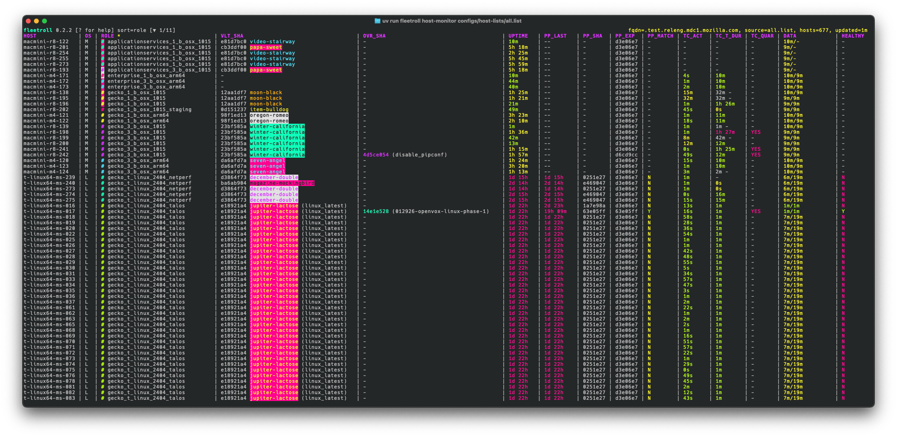

# Fleetroll MVP

[](https://github.com/mozilla-platform-ops/fleetroll_mvp/actions/workflows/ci.yml)
[](https://codecov.io/gh/mozilla-platform-ops/fleetroll_mvp)
[](https://www.python.org/downloads/)
[](https://github.com/astral-sh/ruff)

<p align="center">
  
</p>

Fleetroll MVP streamlines host state visibility and configuration management. It's a tool for auditing, monitoring, and managing Linux and macOS hardware (i.e. long-running) hosts in the Mozilla FirefoxCI Taskcluster environment using Puppet. It's designed for the Mozilla Release Operations team.

Fleetroll MVP spec: [`specs/README_FleetRoll_MVP.md`](specs/README_FleetRoll_MVP.md)

Fleetroll MVP aims to solve the problems mentioned in `Problem Statement` section of the Fleetroll (non MVP) spec ([`specs/FleetRoll_Product_Spec_v5.md`](specs/FleetRoll_Product_Spec_v5.md)).

## Functionality

Fleetroll MVP current functionality includes:

- host file management: files critical to the deployment process
  - override file management: read/set/unset actions
    - set performs file syntax validation
  - vault.yaml file management: read/set actions
  - audit logging: all write (set/unset) operations are logged
- host data collection
  - override and vault.yaml information, uptime, and other various system metrics.
  - puppet run metadata generation and collection: collector script gathers data generated via provided shell function
    - ensures a more positive confirmation that an override or git sha has been applied
- taskcluster data collection: gathers data on connectivity and job status on monitored hosts
- reporting: view all (or almost all) of the collected data
  - two display modes: live-updating interactive curses TUI or non-interactive single report mode
  - includes columns to help make a decision about the state of a rollout

Fleetroll MVP lacks the full features of Fleetroll including:

- fleet management (integration with other datasources, global state database, ingestion of hosts)
- orchestration of the rollout process
  - define a rollout including branch to test (to generate the override) and an optional vault.yaml, rollout speed, hosts
  - start/stop/pause/rollback the rollout
  - monitoring of the rollout process
- distributed application architecture
  - network-accessible API with authentication and authorization
  - persistence / data store


## Background: Puppet Lifecycle

For background on the puppet lifecycle in our environment, see [docs/puppet-execution-mechanisms.md](docs/puppet-execution-mechanisms.md).

## Puppet State File

Fleetroll uses a puppet state metadata file for ground-truth tracking of what puppet has actually applied on each host. This eliminates the need for complex timestamp-based heuristics when verifying rollout health.

**Location**: `/etc/puppet/last_run_metadata.json` (Linux), `/opt/puppet_environments/last_run_metadata.json` (macOS)

**What it does**:
- Written automatically by the puppet wrapper script after each run
- Contains git SHA, override SHA, vault SHA, success status, and timestamps
- Read by `fleetroll gather host` via SSH to populate monitor data
- Enables reliable APPLIED status checking through SHA comparison

**Integration**:
- Reference implementations available in `references/` directory
- See [`docs/puppet-state-tracking.md`](docs/puppet-state-tracking.md) for complete details
- See [`references/README.md`](references/README.md) for deployment guide


## Setup

### Requirements

A modern terminal emulator is required for the curses-based monitor interface:
- **WezTerm**: Works well (recommended)
- **Ghostty**: Works well (minor help menu rendering issue)
- Traditional terminals (Terminal.app, older xterm) may have display issues

### Supported Platforms

FleetRoll supports both Linux and macOS (Darwin) hosts with automatic OS detection:

- **Linux**: Uses paths `/etc/puppet/ronin_settings` (override), `/root/vault.yaml` (vault)
- **macOS**: Uses paths `/opt/puppet_environments/ronin_settings` (override), `/var/root/vault.yaml` (vault)
- **Both**: Use `/etc/puppet_role` (role)

Paths are automatically detected based on the remote host's operating system.

### Installation

Install dependencies with the following commands.

```bash
# install uv (https://docs.astral.sh/uv/getting-started/installation/)
curl -LsSf https://astral.sh/uv/install.sh | sh

# install python deps
uv sync

# if you run `source ./.venv/bin/activate` to activate the uv venv you can drop
# the `uv run` from fleetroll commands (below and in general).
```

`fr` is a shortcut for `fleetroll`: use `uv run fr <command>`, or
`fr <command>` when the virtual environment is activated.

## Usage

Refer to `--help` for complete usage.

Commands are grouped by resource: `host`, `override`, `vault`, `note`, `gather`,
`fleet`, `rollout`, `data`, and `debug`; `web` stands alone. For example,
`fr override --help` lists override actions. `fr` is a shortcut for `fleetroll`.
The former flat command names remain supported as hidden compatibility aliases.
Use `fr gather all HOST_OR_FILE` for combined host, Taskcluster, and GitHub
collection; the legacy `fr gather HOST_OR_FILE` spelling also works. The gather
action names `all`, `host`, `tc`, and `gh` are reserved: use `./host` for a file
named `host`, or a FQDN for a hostname matching an action name. Action options
follow the action, for example `fr gather all --quiet hosts.list`.

### Quickstart

```bash
# gather mac data (host data, TC data, and Git data)
./tools/gather-generic.sh configs/host-lists/mac/all.list
# you can use `watch` to run this every X minutes

# display data in an interactive TUI
uv run fleetroll host monitor  configs/host-lists/mac/all.list
```

### Gathering Data

Data has to be gathered before running reports.

Running these with `watch -n 300 <command>` is how I'm currently using them. In the future, there may be a command that runs both scans regularly on a set of hosts.

#### Host data

The `gather host` command stores host observations in SQLite (`~/.fleetroll/fleetroll.db`) and places all observed overrides and vault.yamls in `~/.fleetroll/overrides` and `~/.fleetroll/vault_yamls`.

```bash
# audit a single host
uv run fleetroll gather host t-linux64-ms-238.test.releng.mdc1.mozilla.com

# audit several hosts in one invocation
uv run fleetroll gather host t-linux64-ms-001 t-linux64-ms-173

# audit a list of hosts
uv run fleetroll gather host configs/host-lists/1804.list
```

`gather host` accepts one or more hostnames, or a host-list file. When gathering
multiple hosts, pass all hostnames in the same command; use a host-list file for
larger sets.

#### TaskCluster data

```bash
# fetch TaskCluster worker data for hosts (stores in ~/.fleetroll/fleetroll.db)
uv run fleetroll gather tc configs/host-lists/1804.list

# verbose output (shows API calls)
uv run fleetroll gather tc -v configs/host-lists/1804.list
```

For Linux and macOS, `gather host` records the configured Taskcluster worker
identity (provisioner, pool, group, and worker ID). `gather tc` uses that identity,
so new roles and pools do not need entries in Fleetroll's role mapping. Refresh
host observations after changing worker configuration. Configuration identifies
which worker to query; it does not establish that the worker is running.

Older observations without identity collection metadata use the legacy
role/override mapping with a warning. An explicit identity collection failure
requires a successful `gather host` refresh; Fleetroll does not fall back to a
possibly outdated pool. Unresolved hosts, missing workers, and API failures make
`gather tc` exit nonzero, including in quiet mode. Successful hosts are still
saved, and failed hosts retain their previous TC observation timestamps.
The latest completed lookup attempt is stored separately for each requested host,
including failures. Monitor JSON exposes that result and its queried identity
without refreshing the retained successful observation's timestamp. See the
[monitor JSON contract](docs/monitor-json.md) for lookup statuses and migration.
Quiet mode prints status, collected/requested counts, and elapsed time in at most
80 characters. Use
`uv run fleetroll gather tc -v <host-list>` for per-host diagnostics.

See [worker identity collection](docs/worker-identity.md) for configuration
sources and supported launch configurations.

For SSH-unreachable hosts, monitor JSON also exposes a durable historical worker
identity with its original timestamp and contradiction signals. An explicit
`uv run fleetroll gather tc --use-historical-identity HOST_OR_FILE` queries that
exact identity without changing normal lookup behavior. Historical lookup success
does not clear contradictions or authorize recovery. See the
[version 3 historical identity contract](docs/historical-worker-identity.md).

#### Reviewing rollout jobs on master and overrides

`fleetroll rollout report` groups hosts within a role into verified master
and each distinct override, then compares their recent Taskcluster outcomes.
The same report works after overrides are removed: no special mode is needed.
Refresh the relevant hosts and GitHub references first:

```bash
uv run fleetroll gather all configs/host-lists/linux/2404.list
uv run fleetroll rollout report --role gecko_t_linux_2404_talos

# Pool selection keeps different roles/pools separate
uv run fleetroll rollout report --worker-type gecko-t-linux-talos-2404

# Explicit hosts, including hosts whose overrides were removed
uv run fleetroll rollout report t-linux64-ms-016 t-linux64-ms-017 --json
```

The report includes outcome totals, rates, applied revisions, task-name failure
patterns, and pairwise differences against master over shared time windows.
It also gives master and each override an independent health statement based on
their verified report-window tasks, including when no control cohort is available.
This works while deploying overrides or removing them, without choosing a direction.
Only jobs attributable to verified applied configurations enter comparisons;
unknown jobs remain visible as exclusions with coverage counts. Missing controls,
small samples, and incomplete evidence are explicit, not automatic approval.
Defaults are a 24-hour report window, a one-hour observation-gap bound, 20 finished
tasks per comparison side, and an 80% attribution coverage warning threshold.
Low attribution qualifies the observed result without blocking a comparison;
unattributed failures inside its shared window are highlighted separately. Use `--help`
for time-window, evidence-threshold, and per-host detail options.

SQLite retains ten full observations per host and a compact 30-day configuration
timeline. Stable scans extend existing spans; transitions, failures, and writes
preserve uncertainty boundaries. Reports expose the retention cutoff, provenance,
and unknown ranges. See [compact configuration history](docs/configuration-history.md)
for the evidence contract and measured storage costs. Use repeatable
`--observations-file saved-gather.json` options to supply saved gather-host or
host-monitor JSON when older convergence evidence or finer observation anchors are needed. The report
reads these snapshots without modifying the database.

The report uses local Taskcluster credentials in `~/.tc_token` and queries at most
20 recent task runs per host. Full windows warn that earlier jobs may be omitted.
Exit 1 indicates classified task failures/unknown outcomes or query errors;
exit 2 indicates invalid input or unavailable local evidence. Exit 0 is not a
rollout go-ahead. See [rollout report](docs/rollout-report.md) for the
history model, limitations, and versioned JSON schema.

#### Data freshness

`data freshness` reports host-audit and Taskcluster observation freshness
separately. Producing a report exits successfully even when data is stale or
missing; use `--require-fresh` when freshness is a prerequisite for automation.

```bash
# Human-readable report for a host population
uv run fleetroll data freshness configs/host-lists/1804.list

# Fail closed unless every host has fresh host and TC data
uv run fleetroll data freshness \
  --min-fresh-pct 100 \
  --require-fresh \
  --json \
  configs/host-lists/1804.list
```

Taskcluster freshness uses the stored observation timestamp, not the worker's
last-activity timestamp.

#### Data Storage

Fleetroll uses a hybrid storage architecture optimized for different data access patterns:

| Data | Storage | Location |
|------|---------|----------|
| Audit log (set/unset/vault ops) | JSONL (append-only) | `~/.fleetroll/audit.jsonl` |
| Host observations | SQLite | `~/.fleetroll/fleetroll.db` |
| TaskCluster workers | SQLite | `~/.fleetroll/fleetroll.db` |
| GitHub refs | SQLite | `~/.fleetroll/fleetroll.db` |
| Override content | Content-addressed files | `~/.fleetroll/overrides/` |
| Vault YAML content | Content-addressed files | `~/.fleetroll/vault_yamls/` |

**SQLite features:**
- **WAL mode** for concurrent reader/writer access
- **Hybrid schema**: indexed lookup columns + JSON blob for full record
- **Retention**: keeps latest N records per key (default 10)
- **Maintenance**: `fleetroll data maintain` performs WAL checkpoint + VACUUM

### Viewing Data

#### Once

```bash
uv run fleetroll host monitor configs/host-lists/1804.list --once
```

##### Filtering and hostname-only output

```bash
# list hostnames matching an override filter (e.g. audit a specific override rollout)
uv run fleetroll host monitor --filter 'ovr_bch~05032026-1804-resolverd-wedging' --once configs/host-lists/linux/all.list --hostname-only
```

##### Filter Query Syntax

Filters are space-separated conditions (all must match). Each condition is `COLUMN OP VALUE`.

**Operators**

| Op | Meaning |
|----|---------|
| `~` | contains (case-insensitive substring) |
| `=` | equals |
| `!=` | not equals |
| `>` `<` `>=` `<=` | numeric for time columns, lexicographic otherwise |

**Columns**

| Column | Aliases | Type | Description |
|--------|---------|------|-------------|
| `host` | | string | hostname |
| `os` | | string | operating system |
| `role` | | string | Puppet role |
| `sha` | `ovr_bch`, `ovr_sha` | string | override branch / SHA (TUI marks a `*wt` suffix when the override sets a worker pool) |
| `wt_ovr` | | string | override sets a TC worker pool: `y`/`n`/`-` (filter-only †) |
| `vlt_sha` | | string | vault SHA |
| `uptime` | | duration | host uptime |
| `pp_last` | | duration | time since last Puppet run |
| `pp_sha` | | string | SHA Puppet last applied |
| `pp_exp` | | string | expected SHA |
| `pp_match` | | string | Puppet SHA match status |
| `tc_act` | | duration | TaskCluster last activity |
| `tc_j_sf` | `tc_t_dur` | duration | TC job time since finish |
| `tc_quar` | | string | TC quarantine status |
| `pool` | | string | actual TC worker pool name (filter-only †) |
| `data` | | duration | max(audit age, TC age) |
| `healthy` | `health` | string | health status (`y`/`n`) |
| `note` | | string | notes |

Time columns (`pp_last`, `tc_act`, `uptime`, `tc_j_sf`, `data`) accept duration values like `20h`, `90m`, `2d`.

† `wt_ovr` and `pool` can be filtered/sorted on but are not shown as columns in the display yet (e.g. `wt_ovr=y`, `pool~bug2031822`).

##### Private Puppet repositories and HEALTHY

Fleetroll compares the Puppet revision reported by a host (`PP_SHA`) with the
expected branch revision fetched by `gather gh` (`PP_EXP`). For an override that
points to a private GitHub repository, Fleetroll's local GitHub API token must
have read access to that repository. The host's own Git credentials do not
provide access to the local `gather gh` process.

If `gather gh` cannot fetch the private branch, the override branch and applied
Puppet revision can still appear, but `PP_EXP`, `PP_MATCH`, and `HEALTHY` show
`-` when no expected revision is stored. This means Fleetroll cannot determine
health from its current data; it does not mean Puppet failed. To enable the
comparison, configure a token with repository read access under `[github]`
`api_token` in `~/.fleetroll/config.toml`, then run
`uv run fleetroll gather gh --override-delay`. `HEALTHY` becomes `Y` only when
Puppet successfully applied the expected revision and Taskcluster activity is
less than one hour old.

**Special syntax**

- `col=` — match rows where column is missing/empty
- `col!=` — match rows where column has a value
- For `data`, a value means at least one parseable host-audit or Taskcluster age; `?/-` and `-/-` count as empty.
- `os=M|L` — pipe-separated alternatives for `=` and `!=`
- `sort:COL[:asc|desc][,COL...]` — sort by one or more columns (unknown values sort last)

**Examples**

```bash
# hosts where Puppet hasn't run in over 20 hours
healthy=n pp_last>20h

# hosts with a specific override branch
ovr_bch~05032026-1804-resolverd-wedging

# hosts whose worker pool is set by an override (or in a specific pool)
wt_ovr=y
pool~bug2031822

# Linux hosts sorted by most-stale Puppet run
os=L sort:pp_last:desc

# hosts with no note set, sorted by TC activity
note= sort:tc_act:desc

# hosts running either macOS or Linux
os=M|L
```

##### JSON output

Monitor JSON preserves raw host audit fields and adds configured worker pool,
host-collected identity, and Taskcluster evidence with timestamps and statuses.
See the [versioned monitor JSON contract](docs/monitor-json.md) for examples,
follow-mode semantics, and automation migration guidance.

```bash
# emit one JSON object per host instead of a table
uv run fleetroll host monitor configs/host-lists/1804.list --once --json

# extract unique roles across all hosts
uv run fleetroll host monitor configs/host-lists/all.list --once --json \
  | jq -r '[.[].observed.role] | map(select(.)) | unique[]'

# extract unique operating systems across all hosts
uv run fleetroll host monitor configs/host-lists/all.list --once --json \
  | jq -r '.[].observed.os_type' | sort | uniq
```

#### Live-Updating Curses Interface
```bash
uv run fleetroll host monitor configs/host-lists/1804.list
# keys: q quit, up/down (or j/k) scroll, left/right horizontal scroll, PgUp/PgDn page
```

### Web Interface

```bash
# single process (uses pre-built frontend)
uv run fleetroll web
# open http://localhost:23847

# dev mode (live frontend reloading)
uv run fleetroll web --dev          # terminal 1
pnpm --dir web dev                  # terminal 2
# open http://localhost:5173
```

To rebuild the frontend after changes: `pnpm --dir web build`

### Override management

Create an override from an upstream branch, a PR number, or a GitHub PR URL:

```bash
uv run fleetroll override create my-branch
uv run fleetroll override create my-branch --worker-type gecko-t-linux-talos-2404-tc-v115
uv run fleetroll override create 123 --output-dir configs/overrides
uv run fleetroll override create https://github.com/mozilla-platform-ops/ronin_puppet/pull/123 --output rollout.override
```

The command verifies the exact branch exists before creating the file, resolves
fork repositories for PRs, and refuses to overwrite existing files. It requires
`git` and network access, plus `gh` for PR inputs. Output defaults to a generated
filename in the current directory; parent directories must already exist.
`tools/create_override.sh` remains a wrapper with `configs/overrides` as its
default output directory. Without `--worker-type`, generated files leave the worker
type assignment empty and commented out, and use the usual base filename. With
`--worker-type <type>`, the file sets `WORKER_TYPE_OVERRIDE` and its generated name
ends in `-wt-<type>.override` (for both branch and PR inputs). Pass a bare worker
type, without a provisioner prefix. An explicit `--output` path is used exactly
as supplied, including when a worker type is set. Verify that the worker type
matches every target host's role before deployment.

When an override sets `WORKER_TYPE_OVERRIDE`, `override set` checks each
host's latest successful recorded role against its normal worker type. The base
type or a nonempty hyphenated suffix is accepted. Unknown roles and mismatches
block the entire deployment; use `--allow-worker-type-mismatch` for intentional
exceptions. Previews show the role observation timestamp so operators can decide
whether to refresh with `gather host`. There is no freshness cutoff or automatic
refresh. See [worker type safety](docs/override-worker-type-safety.md) for details.

Summarize override coverage for a recorded Puppet role or Taskcluster pool:

```bash
uv run fleetroll fleet status --role gecko_t_linux_2404_talos
uv run fleetroll fleet status --worker-type releng-hardware/gecko-t-linux-talos-2404 --json
uv run fleetroll fleet status --role gecko_t_linux_2404_talos configs/host-lists/linux/all.list
```

Both commands accept a bare worker type, which defaults to the `releng-hardware`
provisioner, or an explicit `provisioner/worker-type`.

Percentages use confirmed matching hosts as the denominator. Unknown membership,
failed refreshes, and Fleetroll writes awaiting verification are reported separately.
The latest successful observations are used regardless of age; manual changes after
an observation may not be reflected. Without a host list, the population consists of
hosts identifiable from Fleetroll's recorded observations.
Use `--verbose` to show host lists, or `--json` for machine-readable details.

Both `fleet status` and `rollout report` fetch the current approximate number of
pending Taskcluster tasks for each effective worker pool. Counts cover the whole
pool, including workers outside the selected hosts or role, and include a fetch
timestamp. Pools are resolved from recorded worker identities, with legacy
role/override mapping for older observations. Queue lookup failures appear as
unavailable and do not prevent the recorded report from rendering or change its
exit status. Public queue counts need network access but no Taskcluster credentials
(`rollout report` still needs credentials for its worker/task queries).

```bash
# show stored override contents by sha prefix or human hash
uv run fleetroll override show 0328af8c9d6f
uv run fleetroll override show freddie-arkansas

# set override (single host)
uv run fleetroll override set --from-file ~/.fleetroll/overrides/0328af8c9d6f t-linux64-ms-229.test.releng.mdc1.mozilla.com

# set override (host list)
uv run fleetroll override set --from-file ~/.fleetroll/overrides/0328af8c9d6f configs/host-lists/1804.list

# unset override (host list)
uv run fleetroll override unset configs/host-lists/1804.list
```

### Operator hold

`host hold` inspects or changes `/home/cltbld/operator_hold` on one Linux host.
The flag prevents new jobs from running; setting it does not prove an existing
job has finished. These commands use live SSH checks and do not depend on gwhc.

```bash
uv run fleetroll host hold show t-linux64-ms-017
# Preview without contacting the host:
uv run fleetroll host hold set t-linux64-ms-017 --reason "maintenance"
uv run fleetroll host hold set t-linux64-ms-017 --confirm --reason "maintenance"
uv run fleetroll host hold clear t-linux64-ms-017 --confirm --reason "maintenance complete"
```

Set and clear require `--confirm`, verify the resulting file state, and audit the
actor, optional reason, and outcome (including no-ops and failures). Repeating
an already-satisfied operation succeeds without changing the existing file.
`show` is read-only and needs no confirmation. All actions support `--json` and
the standard SSH options; failures return nonzero and never claim a verified
hold state. Unsupported OSes, missing worker homes, symlinks, and nonregular flag
paths are refused. The privileged file operation requires passwordless
`sudo -n sh` access. Recorded host observations and monitor columns are not
updated by these commands; use `host hold show` for current hold status.

### Checking whether a host is idle

`host idle` checks one Linux host over SSH using live `sudo -n gwhc --json`
and a separate Puppet process check. It reports the worker state (`idle`,
`working`, or `unknown`), whether Puppet is running, check timestamps, and
supporting health details. `WORKING` and `BUSY` health states both mean working.
The host is reported idle only when the worker is idle and Puppet is not running.

```bash
uv run fleetroll host idle t-linux64-ms-017
uv run fleetroll host idle t-linux64-ms-017 --json
```

Known idle and working results exit 0; unknown or failed checks exit 1, with
the JSON result still printed. Missing gwhc, unsupported operating systems,
SSH failures, and unavailable Puppet activity never count as idle. This command
does not change the host or overwrite recorded host observations.

This is a snapshot of gwhc's current assessment, which uses heuristics and can
miss stale worker state. It does not reserve or quarantine the worker; a new
task may start immediately afterward. Recheck before taking an action.

### Rebooting an idle worker

`host reboot-if-idle` checks a Linux host's live `sudo gwhc --json` output and
requests a reboot only when its top-level `state` is exactly `IDLE`. It targets
one host per invocation and requires `--confirm` to run the check and request
reboot:

```bash
# preview the target and action
uv run fleetroll host reboot-if-idle t-linux64-ms-001

# check gwhc and request reboot when state is IDLE
uv run fleetroll host reboot-if-idle t-linux64-ms-001 --confirm
```

This operator-triggered best-effort command does not quarantine the worker or
recheck its state. A task may be claimed after the check, and current `gwhc`
heuristics may report stale or unknown state as `IDLE`. Do not use it for
unattended or fleet-wide reboot policy. Fleetroll reports that a reboot was
requested; it does not claim the host recovered.

### vault.yaml management

```bash
# show stored vault contents by sha prefix or human hash
uv run fleetroll vault show 0328af8c9d6f
uv run fleetroll vault show jupiter-lactose

# set vault (single host) - defaults to /root/vault.yaml
uv run fleetroll vault set --from-file vault.yaml t-linux64-ms-229.test.releng.mdc1.mozilla.com

# set vault (host list)
uv run fleetroll vault set --from-file vault.yaml configs/host-lists/1804.list
```

### Debugging

```bash
# print the remote audit script (useful for debugging)
uv run fleetroll debug host-script

# wrap as ssh-ready command
uv run fleetroll debug host-script --wrap
```


## Development

### Release notes

`uv run release-notes` generates an Unreleased draft from committed changes after
the latest version bump. Choose and commit a version when preparing a release,
then generate its draft with `uv run release-notes --version 0.3.0`. See the
[release notes workflow](docs/release-notes/README.md) for review and publication
steps and the transition from version eras to release boundaries. Every release
gets a `vX.Y.Z` tag and a published
[GitHub Release](https://github.com/mozilla-platform-ops/fleetroll_mvp/releases)
using the reviewed notes committed in this repository.

### TODOs

Stored in beads. See `AGENTS.md` for more info.

### Testing

```bash
# install testing deps
uv sync --all-groups
# prek (https://github.com/j178/prek, git commit hooks)
brew install prek
# actionlint (URL?, github actions linting)
brew install actionlinst
# beads-rust (https://github.com/Dicklesworthstone/beads_rust, repo issue tracking)
curl -fsSL "https://raw.githubusercontent.com/Dicklesworthstone/beads_rust/main/install.sh?$(date +%s)" | bash
# cass (https://github.com/Dicklesworthstone/coding_agent_session_search)
curl -fsSL "https://raw.githubusercontent.com/Dicklesworthstone/coding_agent_session_search/main/install.sh?$(date +%s)" \
  | bash -s -- --easy-mode --verify

# testing
uv run pytest

# pytest-watcher (runs tests on any change)
uv run ptw .
```

To reproduce CI coverage locally, including the tmux integration tests:

```bash
uv run pytest --cov=fleetroll --cov-report=xml --cov-report=term
```

Coverage enables subprocess measurement so monitor code running inside tmux is
included in the combined report. Each test starts an isolated tmux server that
inherits the coverage environment. TUI teardown sends Ctrl-C and polls for exit
before removing the server, allowing Python cleanup and coverage writes to finish
even when a popup is open. If the app does not exit within five seconds, teardown
warns and forces shutdown; that process's coverage may be incomplete. Tests can
still run normally without `--cov`.
